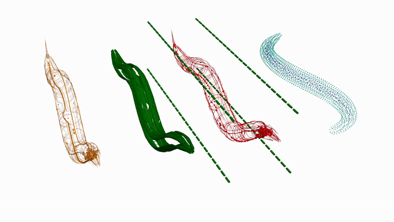

# Worm3DViewer

A 3D viewer for several _C. elegans_ models and datasets from the [OpenWorm](https://openworm.org) project, built with [PyVista](https://pyvista.org/) and deployed as a [Streamlit](https://streamlit.io/) web app. It is intended as a replacement for the OpenWorm Browser.

**Work in progress!**

<p align="center"></p>

It can show, side by side in one scene:

- **VirtualWorm** meshes of the body wall muscles (`bwm.obj`) and the neurons (`neurons.obj`)
- a **NeuroML** model of the worm: the c302 network (`NeuroML2/c302_D_Full.net.nml`) with morphologically detailed cells
- a **Sibernetic** simulation of the worm body: a replay of the particle positions (`Sibernetic/position_buffer.txt`)

## Running

Python 3.12 to 3.14 is tested (CI uses 3.12 and 3.14, the Docker image 3.13).

```bash
pip install -r requirements.txt
streamlit run app.py            # the web viewer
```

With Docker:

```bash
./build.sh              # build the image (add -r for --no-cache) and open a shell in it
./runLocal.sh           # run the built image with a shell, port 8080 exposed
./stop.sh               # stop and remove the container
# The image's entrypoint is `streamlit run app.py` on port 8080
```

### Command line scripts

Each model can also be shown on its own in a desktop window:

```bash
python neuromlmodel.py          # a NeuroML network (default c302_D_Full.net.nml)
python neuropal.py              # NeuroPAL coloured cells (somas only)
python virtualworm.py           # VirtualWorm muscle + neuron meshes
python SiberneticReplay.py Sibernetic/impermeability.txt   # Sibernetic replay
python load.py                  # all of the above in one scene
```

Add `-nogui` to any of them to load everything without opening a window. This is what the tests use.

## The web viewer

The controls are in four panels above the 3D view, in the order they are intended to be used:

| Panel | Controls |
|---|---|
| **3D Canvas** | Which models to show: VirtualWorm, NeuroML models, Sibernetic model, etc. |
| **Select Subsets** | Which cells to show: all cells, only muscles, only neurons, sensory neurons, interneurons, motor neurons, pharyngeal neurons, or "Specific cells..." for a list picked by name. The same cells are shown in each worm |
| **Color Overlay** | **Default** uses the colours of each loaded model; **Random** gives each named cell a random colour (repeatable for a given name, and the same in every model) |
| **Display Options** | Background colour of the 3D view (green, white or black) and the spacing between the worms (0 to 50: lower values move them closer together) |

Changing any control rebuilds the scene. A "Worms are loading..." spinner is shown meanwhile.

Notes:

- Cell names are the standard names, e.g. `AVAL` for a neuron or `MDL01` for a body wall muscle.
- Subsets apply to the NeuroML and VirtualWorm models. For the Sibernetic model only the muscles have names, so only muscle names select or colour particles there (see below). Selecting a group with no muscles, such as the neurons, shows no Sibernetic particles.
- The camera position is not kept when the scene is rebuilt.
- Large selections (all of the neurons, or the whole NeuroML model) take a few seconds to build and send tens of MB to the browser.

## Code structure

Each data source has its own module with an `add_*(plotter, ...)` function that adds geometry to a shared `pyvista.Plotter`, and an `if __name__ == "__main__"` block so it can be run alone. They all take the same two optional arguments:

- `only_show`: a list of cell names to show; all other cells are omitted. An empty list (the default) shows everything.
- `colors`: a dict of cell name to colour (a name, or an rgb tuple) used instead of the default colour. Cells not in the dict (or an empty dict) keep their default colour.

| File | Contents |
|---|---|
| `app.py` | The Streamlit app: the control panels, building the scene from the controls, and the page styling. The `-gui` argument runs the same scene in a desktop window instead |
| `load.py` | The same models combined in a desktop (non-Streamlit) window |
| `neuromlmodel.py` | `load_neuroml_model(file)` reads a NeuroML file; `add_neuroml_model(plotter, nml_doc, ...)` adds its cells. The geometry of each cell is built once and kept on the loaded document, so adding it again is fast |
| `virtualworm.py` | `load_virtualworm()` reads the muscle and neuron meshes (one coordinate system); `add_virtualworm()` adds them |
| `urlparams.py` | Reads the options given in the URL (`?model3d=...&show=...&highlight=...&colours=...&background=...&spacing=...`) as the initial values of the controls |
| `SiberneticReplay.py` | `add_sibernetic_model()`: a time series replay of Sibernetic output with play, rewind and fast forward buttons, a time slider, toggles for the particle types and charts of the muscle activation and body curvature |
| `SibSimulation.py` | The data layer for the replay (no GUI): reads `position_buffer.txt` and/or `report.json` from a Sibernetic run directory |
| `sibernetic_muscles.py` | Maps the named Sibernetic muscles to particles (see below) |
| `NeuroML2/` | The NeuroML model files (c302 networks, NeuroPAL, `cells/`) |
| `Sibernetic/` | Sample Sibernetic output and the muscle to particle map |

Things worth knowing:

- **Loading and adding are separate.** The `load_*` functions read files and return objects that the `add_*` functions only read from. In the Streamlit app they are wrapped in `st.cache_resource`, so each file is read once and changing the cell selection only re-adds cells to a new plotter. The cache is shared by all browser sessions.
- **The 3D view.** The scene is shown with stpyvista using the `panel` backend, which needs no extra dependencies (the default `trame` backend does). Streamlit runs the script on a non-main thread, so the plotter is created off-screen, and it is closed after export because a new one is built on every rerun. The view is re-mounted when the selection changes, by including the selection in its key. `xvfb` is started on Linux when there is no display (the Docker image).
- **stpyvista cannot be imported outside Streamlit**, so scripts that run it standalone must not import it.
- **VirtualWorm meshes** (`bwm.obj`, about 25MB, and `neurons.obj`, about 100MB, both in the repo) are read by a small parser in `virtualworm.py` instead of trimesh. With trimesh 5, every object in `neurons.obj` came back with the name of the first, so the cell names were lost. A cell can be made of several objects (e.g. `MVL22_81`), and `only_show` and `colors` match the cell name without the number.
- **NeuroML coordinates** are remapped to the viewer's frame as `(x, z, -y)` and scaled by `factor`.
- **Theme.** `.streamlit/config.toml` sets the colour of selected controls to the dark green of the page. The rest of the look (green page, compact panels) is CSS in `app.py`.
- **Positioning.** Models are placed side by side using the `translate=` / `offset3d=` arguments, scaled by the spacing setting.

### Sibernetic muscles

In a Sibernetic configuration a muscle is not a set of particles but a set of elastic connections tagged with a muscle id (1 to 96, in four quadrants of 24 muscles named MDR, MVR, MVL and MDL, 01 to 24). `sibernetic_muscles.py` works out the particles of each named muscle from a configuration file:

```bash
python sibernetic_muscles.py CONFIGURATION_FILE -o muscles.json
```

The result for `worm_alone_half_resolution` is in `Sibernetic/muscle_particles_worm_alone_half_resolution.json`, and `add_sibernetic_model()` uses it for `only_show` and `colors`. The module documentation there explains how this was derived from the Sibernetic C++, and has a list of **open issues**. The main ones are that it has not been established which end of the body row 01 is at (head or tail), which side is left, and that only that one configuration has been checked.

## Tests and CI

There is no pytest. `./test.sh` is the test suite: it runs `ruff format` and `ruff check` and then each loader script with `-nogui` as a smoke test (to run a single test, run the script on its own with `-nogui`). Keep the `-nogui` / `-gui` handling in scripts, as it keeps them testable without a display.

GitHub workflows:

- `non_omv.yml`: Python 3.12 and 3.14, `pip install -r requirements.txt` then `./test.sh`
- `docker-image.yml`: runs `./build.sh`
- `omv-ci.yml`: validates the NeuroML2 files with OMV (`osb-model-validation`) and the `jNeuroML_validate` engine

The Streamlit app itself is not covered by `test.sh`. It can be exercised without a browser with Streamlit's `streamlit.testing.v1.AppTest`.
